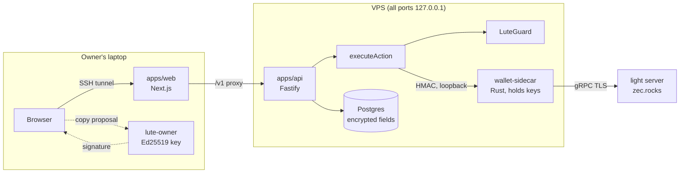

# Lute

**Private payments on Zcash, with a policy engine that fails closed.**

Lute lets a merchant or creator take shielded payments, stream earnings per second, and pay people
out, all on Zcash mainnet, without ever falling back to a transparent or cross-pool transaction.
Every spend goes through one engine: **LuteGuard** checks the exact transaction the wallet built,
the owner signs that exact proposal on their own machine, and only then does the wallet sidecar
broadcast it. If privacy can't be kept, nothing happens.

Built for ZECATHON 2026 (Shielded Payments track).

> Status is **computed, never chosen**: the Privacy Center derives each module's status from the
> latest test run (`evidence/results.json`) and on-chain evidence (`docs/PRIVACY-EVIDENCE.md`).
> Only PROVEN is presented as working.

## What works (PROVEN)

| Module | Evidence | Mainnet txids |
|---|---|---|
| **Send**: owner-approved shielded payouts, single pool (Ironwood), zero transparent | E-002, E-005, E-006, E-007 | `3c129cfbbe5d142e96512f4fd7e26db7f27e7574a95947fccab74414fc73f142`, `546a16b489400b415eb382b43ee5d5ff489e7e6b6eb212927a241b6ea57682bd` |
| **Receive and payment requests**: a Zodl wallet pays a Lute request; matched by unique address **and** memo, PAID only after 3 confirmations | E-004 | `a25de13d03273f581df7799254a4deb9c3ddc031d316d59456fa2c8e0335f250` |
| **Per-second streams**: accrual on the server clock, owner-approved shielded settlements, earned and paid shown separately | E-008 (mainnet), E-009 (regtest) | `0517b048d4830f00dd27a35919443c4a1931164329f7c41893853296bbf2a49c`, `aa5294dd01a59b788dacbd562afca471d3cdfccb11a21d22457c89898be72f7d` |
| **LuteGuard**: mandatory, deterministic policy engine (transaction, metadata, authorization, settlement, integration policies); ALLOW recorded before authorization | E-006 | (same as Send) |
| **Privacy Center**: computed status, stored decisions, limitations | test suite | — |

Latest run: 207/207 tests pass (luteguard 50, core 58, api 35, sidecar 60, lute-owner 4).

Streams are **payer-controlled, not trustless**. Payouts stop if the payer stops authorizing.

## What is not (and how it is labeled)

| Module | Status | Why |
|---|---|---|
| Cross-chain route classification | PARTIAL | The classifier works; no route is classified `STRICT_PRIVATE_VERIFIED`, so execution is off |
| Commerce and refunds, Groups, Metered billing, Subscriptions | ROADMAP | Not available in this build: no route, SDK method or MCP tool reaches them |
| Agent mandates (SDK and MCP spends) | ROADMAP | No mandates in this build, so LuteGuard denies any agent spend (fails closed) |

## How a payment flows



1. The API creates an action. `executeAction` (the only path to a spend) asks the sidecar to **inspect** the recipient and build a **proposal**.
2. **LuteGuard** evaluates that exact proposal: shielded recipient, single pool, no transparent or Orchard inputs, fee from the library, opaque memo, network, idempotency, caps. The decision (reason codes only) is stored.
3. The owner reviews the proposal on their laptop with `lute-owner`. It recomputes the proposal hash and signs only after a typed confirmation (`approve <hash8>`). The key never leaves the laptop.
4. The sidecar independently re-checks policy, the signature, hash binding, one-use approval, TTL (300 s) and caps (2,000,000 zat per tx, 5,000,000 zat per day), then signs and broadcasts **once**.
5. Payments count as paid only after confirmations.

## Privacy: who learns what

| Party | Learns |
|---|---|
| Public chain observer | That a shielded transaction happened in the Ironwood pool, and its fee. Not sender, recipient, amount or memo. |
| Payer | Amount and the merchant's request address for that one request. |
| Recipient | Amount and memo of what they received. |
| Lute server (operator) | Its own wallets' activity. Recipients and memos are stored encrypted at rest (AES-256-GCM); request notes are encrypted in the browser with a key that stays in the link's `#fragment`. |
| Light server (zec.rocks) | The wallet's IP and timing, its birthday height, and, when Lute checks a specific transaction, that this txid interests the wallet. Never keys, amounts or memos. See `docs/PRIVACY.md`. |

**Custody disclosure.** The `merchant` and `payout` wallets are **operator-custodied hot wallets** on the server (each in its own wallet database and sealed key file, kept at or below 0.1 ZEC; the sidecar warns above that). Customers pay from their own wallets (e.g. Zodl); Lute never touches payer keys. Lute's software releases a spend from a Lute wallet only with the owner's signature (or a signed agent mandate); this is enforced by software, not by the chain, so the operator can bypass it. There is no independent recovery yet. See [docs/CUSTODY.md](docs/CUSTODY.md).

**Next: browser-signed, non-custodial payments.** Lute prepares each payment and only the user's browser can sign it, so Lute holds no key that can move user funds (viewing key only). Design in [docs/CUSTODY.md](docs/CUSTODY.md#next-browser-signed-non-custodial-payments).

## Repository

```
services/wallet-sidecar   Rust: the only component with keys. Inspect, propose, approve, execute, sync, verify (librustzcash)
tools/lute-owner          Rust: owner Ed25519 key tool (init, pubkey, sign with typed confirmation)
packages/luteguard        TS: policy engine (pure, deterministic)
packages/core             TS: action state machine, executeAction, exact money math, streams, computed status
apps/api                  TS: Fastify + Drizzle + Postgres 16; auth, actions, requests, streams, Privacy Center feed
apps/web                  TS: Next.js dashboard, pay page, Privacy Center
infrastructure/           Z3 regtest overlay and evidence scripts, VPS deploy (loopback only, capped logs)
evidence/                 regtest and mainnet logs, results.json (generated by pnpm test:evidence)
docs/                     mandate, decisions, threat model, privacy analysis, evidence table, build status
```

## Run it

Requirements: Node 24, pnpm 10, Rust stable, Docker (for Z3 regtest and Postgres).

```bash
pnpm install --frozen-lockfile
pnpm -r build && pnpm -r test          # TS suites (PGlite, no services needed)
cd services/wallet-sidecar && cargo test --locked
pnpm test:evidence                     # runs everything, writes evidence/results.json
```

Regtest (Z3: Zebra 6.2.3 + Zaino 0.10.2, NU6.3 active): see `infrastructure/z3/` (`setup-vps.sh`,
`fund-fixture.sh`, `w17-send-receive.sh`, `approvals-evidence.sh`, `streams-regtest.sh`).

Deployment used for the evidence: `infrastructure/api/` (Postgres, API, web on 127.0.0.1) and the
sidecar as a systemd unit (`infrastructure/sidecar/`), reached by the owner over an SSH tunnel.
`tools/lute-pay.ps1` is the owner's helper for paying and streaming from the terminal.

## Limitations

- Lute's wallets are hot wallets on one server; field encryption is at rest, not end-to-end.
- The light server learns network-level metadata (above). A self-hosted Zebra + Zaino removes the third party but not the server's own view.
- Each settlement is a full shielded transaction with a 10,000 zat fee, so small streams should settle rarely. A settlement needs confirmed notes; back-to-back settlements wait for change to confirm.
- No external security review yet (self-review only).
- Agent spends, metered billing, subscriptions, groups and commerce are not in this build.

## Attributions

- [librustzcash](https://github.com/zcash/librustzcash): `zcash_client_backend` 0.24, `zcash_client_sqlite` 0.22, `zcash_keys`, `zcash_primitives`, `zcash_proofs`, `zcash_address`, `zcash_protocol`, `zip321`
- [zcash-devtool](https://github.com/zcash/zcash-devtool): reference for crate usage (not used to sign)
- Z3 (Zebra, Zaino) for regtest
- Zodl as the payer wallet in the mainnet evidence
- zec.rocks light servers

## License

MIT
