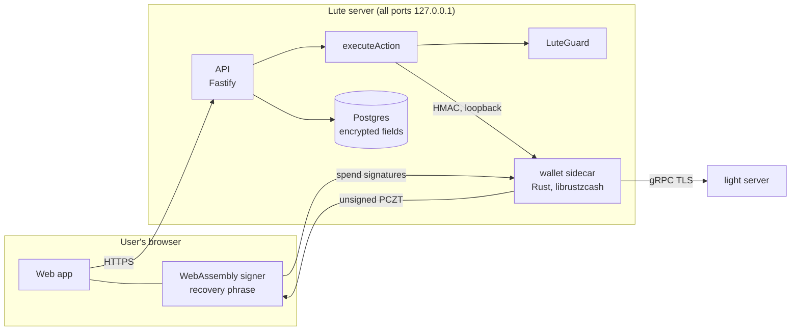

# Lute

**Private payments on Zcash: get paid, pay your team, and let AI agents pay for services, all shielded.**

Live on Zcash mainnet at **https://uselute.xyz**. Built for ZECATHON 2026 (Shielded Payments track).

Every payment stays inside one shielded pool (Ironwood) with nothing transparent. Every spend goes
through one engine, **LuteGuard**, which checks the exact transaction the wallet built before
anything is signed. If privacy can't be kept, nothing is sent. New accounts are **non-custodial**:
the wallet's recovery phrase is created in the browser, and every payout is signed there.

> Status is **computed, never chosen.** The Privacy page derives each module's status from the
> latest test run (`evidence/results.json`) and on-chain evidence (`docs/PRIVACY-EVIDENCE.md`).
> Claims never go beyond the evidence.

## What it does

| Feature | What you get | Evidence |
|---|---|---|
| **Payment links** | A link or QR code; a new shielded address and memo reference per request; *Partially paid / Confirming / Paid* (3 confirmations) | E-004 (mainnet) |
| **Send** | Shielded payouts with a fee preview; you approve every payout | E-005, E-006, E-017 (mainnet) |
| **Non-custodial accounts** | 24-word recovery phrase kept in the browser; Lute gets viewing keys only; the browser checks and signs each transaction; the backup restores the wallet in Zodl | E-016 (regtest), E-017 (mainnet) |
| **Payroll / BatchPay** | Up to 10 people in **one** shielded transaction: one approval, one fee, each person sees only their own pay; private signed payslips; templates; team roles; pay what streams owe | E-019 (regtest), E-020 (mainnet) |
| **Streams** | Pay by the second; earned and paid kept separate; payouts you approve | E-008 (mainnet), E-009 |
| **Checkout** | Orders with signed receipts (salted item hash) and capped refunds | E-012 (regtest) |
| **Subscriptions and split bills** | A private invoice each period (never auto-debit); a link per person for their share | E-013 (regtest) |
| **AI agents (MCP)** | Sign a budget once: one payee, per-payment cap, total, expiry. The agent pays a metered API (document extraction, one-time quotes), outside APIs' invoices (only at the address you signed), HTTP 402 APIs, or another Lute account's service. Over budget is refused before anything is built. | E-010, E-011, E-015, E-018 (mainnet) |
| **Privacy page** | Who can see what; LuteGuard decisions; computed module status; every claim linked to its evidence | E-014: every mainnet transaction audited `SHIELDED_SINGLE_POOL` |

Latest run (`evidence/results.json`): **277 tests pass**: LuteGuard 50, core 64, API 75, MCP 7,
web 5, wallet sidecar 70, lute-owner 6.

## How a payment flows



1. The API creates an action; `executeAction`, the only path to a spend, has the sidecar inspect each
   recipient and build a proposal.
2. **LuteGuard** evaluates that exact proposal: shielded recipients, one pool, nothing transparent,
   fee from the library, memo rules, network, caps, budgets. Its decision is stored with reason codes.
3. The owner approves the exact proposal hash. For non-custodial accounts the browser also checks the
   unsigned transaction (recipients, amounts, only the fee leaving the pool) and signs it.
4. The sidecar re-checks policy, approval (one use, 5-minute expiry), hash binding and caps
   (0.02 ZEC per payment, 0.05 ZEC per day), verifies the signatures, and broadcasts **once**.
5. A payment counts as paid only after confirmations. Interrupted operations are recovered from the
   sidecar's record, never resent.

## Who can see what

| Who | Can see | Cannot see |
|---|---|---|
| Anyone reading the blockchain | That a shielded transaction happened, when, its fee and size | Sender, recipient, amount, memo |
| Light-wallet server | The server's IP, sync timing, transactions it broadcasts or looks up | Amounts, addresses, memos, keys |
| Payer / payee | Their own payment: amount and memo | Your balance and other payments |
| Lute operator, non-custodial accounts | Payments in and out, amounts, timing (viewing keys) | Your keys: it holds no key that can move your money |
| Lute operator, agent wallets and accounts created before 27 Oct 2026 | All of the above | Nothing more: these wallets are Lute-held (custodial) |

Details: [docs/CUSTODY.md](docs/CUSTODY.md), [docs/PRIVATE-PAID-APIS.md](docs/PRIVATE-PAID-APIS.md),
[docs/PRIVACY.md](docs/PRIVACY.md). Caveat: Lute serves the signer code; the non-custodial guarantee
holds against a passive or compromised server, not against an operator who ships different code.

## Repository

```
services/wallet-sidecar   Rust: the only component with keys or Zcash state. Inspect, propose (single or batch),
                          approve, execute, PCZT build/prove/finalize for browser-signed wallets, sync, verify
services/lute-signer      Rust → WebAssembly: browser signer. Derives viewing keys, checks and signs PCZTs
tools/lute-owner          Rust: owner Ed25519 key tool (sign payments and agent mandates with typed confirmation)
packages/luteguard        TS: policy engine (pure, deterministic)
packages/core             TS: action state machine, executeAction, money math, streams, computed status
apps/api                  TS: Fastify + Drizzle + Postgres: auth, payments, requests, streams, commerce,
                          subscriptions, groups, payroll, agents and metered APIs, x402, recovery
apps/web                  TS: Next.js app, public pay/receipt/payslip pages, docs, Privacy page
apps/mcp                  TS: MCP server for agents (budget, sessions, quotes, extraction, invoices, settlement)
infrastructure/           Regtest (Z3) evidence scripts, deployment (loopback only, capped logs)
evidence/                 Regtest and mainnet records, results.json
docs/                     User guide, custody, privacy analysis, evidence register, demo script, decisions
```

## Run it

Requirements: Node 24, pnpm 10, Rust stable, Docker (Z3 regtest and Postgres).

```bash
pnpm install --frozen-lockfile
pnpm -r build && pnpm -r test          # TypeScript suites (in-memory Postgres, no services needed)
cd services/wallet-sidecar && cargo test --locked
node tools/evidence/collect.mjs        # runs everything, writes evidence/results.json
```

Regtest (Z3: Zebra + Zaino, NU6.3 active): `infrastructure/z3/` (`noncustodial-regtest.sh`,
`batchpay-regtest.sh`, `agent-regtest.sh`, `streams-regtest.sh`, `commerce-regtest.sh`, …).
Deployment: `infrastructure/api/` (Postgres, API and web on 127.0.0.1) and the sidecar as a systemd
unit (`infrastructure/sidecar/`); CI builds the Rust binaries and the WebAssembly signer.

Using it: [docs/USER-GUIDE.md](docs/USER-GUIDE.md) (also at https://uselute.xyz/docs), including how
to connect an MCP client. Demo walkthrough: [docs/DEMO.md](docs/DEMO.md).

## Limitations

- Agent wallets and accounts created before 27 Oct 2026 are custodial (Lute-held hot wallets, kept
  small). New accounts are non-custodial.
- The light server learns network metadata (IP, timing). A self-hosted Zebra + Zaino removes the
  third party.
- Each payout is a full shielded transaction (fee about 0.0001 ZEC); BatchPay shares one fee across a
  team, and streams should settle rarely.
- Outside APIs must invoice to one fixed shielded address (a signed budget names its payee in advance).
- No external security audit yet.

## Attributions

- [librustzcash](https://github.com/zcash/librustzcash): `zcash_client_backend`, `zcash_client_sqlite`,
  `zcash_keys`, `zcash_primitives`, `zcash_proofs`, `pczt`, `orchard`, `zip321`
- [zcash-devtool](https://github.com/zcash/zcash-devtool) as a reference for crate usage
- Z3 (Zebra, Zaino) for regtest; zec.rocks light servers; Zodl as the payer wallet in the evidence
- [@scure/bip39](https://github.com/paulmillr/scure-bip39) for recovery phrases

## License

MIT
